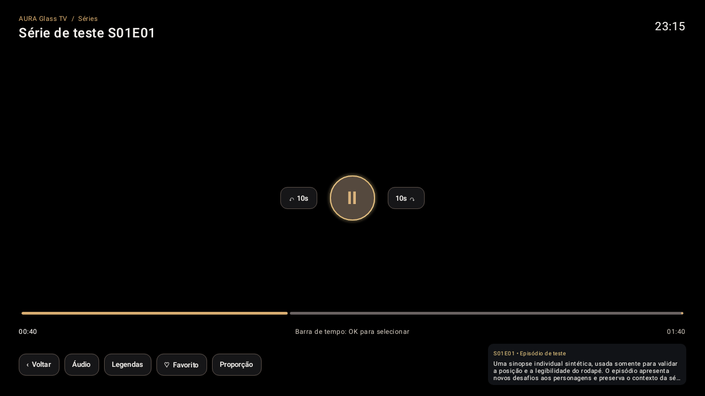
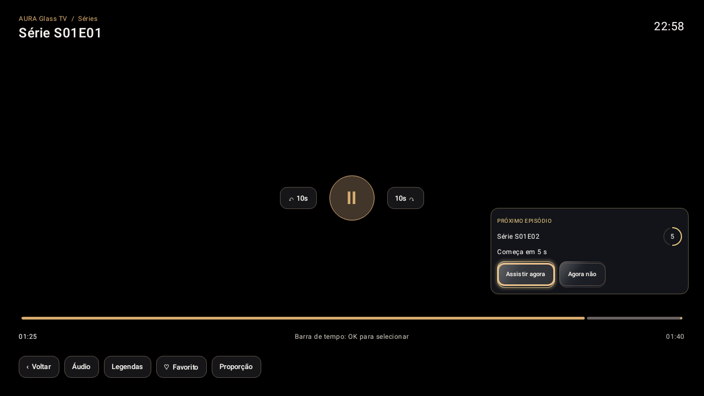

# ✦ AURA GLASS TV

### Sua TV. Seu conteúdo. Sua experiência.

**Uma experiência cinematográfica desenvolvida para Android TV e Google TV.**

## ⏳ DISPONÍVEL EM BREVE

**O lançamento público está em preparação. O download do APK está temporariamente indisponível.**

Acompanhe as novidades por esta página.

---

## Conheça o AURA Glass TV

O **AURA Glass TV** foi pensado para quem deseja aproveitar suas próprias fontes compatíveis de TV ao vivo, filmes e séries com uma interface elegante, intuitiva e desenvolvida especialmente para o controle remoto.

A identidade em **grafite e dourado-champanhe** combina uma navegação organizada com informações de catálogo, favoritos, histórico e retomada de reprodução.

**Sua TV. Seu conteúdo. Sua experiência.**

## Recursos em desenvolvimento e testes

| Recurso | Experiência |
|---|---|
| **◈ Visual Glass Premium** | Interface grafite, acabamento dourado e destaque suave do foco. |
| **▶ Filmes e séries** | Informações, sinopse, detalhes e elenco quando disponíveis. |
| **▤ TV ao vivo** | Categorias e guia eletrônico de programação (EPG), conforme a fonte. |
| **↪ Continuar assistindo** | Progresso de reprodução, histórico e favoritos. |
| **✦ Próximo episódio** | Aviso e reprodução contínua com opções de controle. |
| **☷ Perfis** | Organização por usuário e PIN parental opcional. |
| **＋ Fontes compatíveis** | Suporte a M3U e Xtream Codes de fontes autorizadas. |
| **↑ AURA Update** | Atualizações no próprio aplicativo quando uma versão estiver disponível. |

## Capturas demonstrativas

*Player com controles e informações contextuais.*

*Aviso de próximo episódio.*

Capturas de demonstração técnica com conteúdo sintético; não representam canais ou filmes incluídos.

## ⏳ Download — disponível em breve

**A distribuição pública de novos APKs está pausada neste momento.**

Estamos organizando uma etapa adicional de testes e revisão antes de liberar o aplicativo ao público.

**Não há APK oficial disponível para novos downloads nesta fase.** Quando abrirmos a distribuição, o link será apresentado nesta página.

As instalações que já foram realizadas continuam no dispositivo. Esta decisão **não bloqueia remotamente versões antigas** e não apaga dados.

**Compatibilidade prevista:** Android TV e Google TV com Android 9 (API 28) ou superior. Não é uma versão para Roku, Samsung Tizen ou LG webOS.

## Ajude a desenvolver o AURA

Mesmo antes do lançamento público, sugestões são bem-vindas:

- [🐛 Relatar um problema](https://github.com/eusam66/AURA-Update/issues/new?template=bug-report.yml)
- [✨ Sugerir uma melhoria](https://github.com/eusam66/AURA-Update/issues/new?template=feature-request.yml)

Não compartilhe senhas, contas, dados de usuários, links de playlists ou credenciais em formulários públicos.

## Informações importantes

**O AURA inclui canais ou assinaturas?** Não. O AURA é um aplicativo reprodutor e organizador. O usuário deverá conectar suas fontes compatíveis e legalmente autorizadas. Não fornecemos canais, listas M3U, credenciais Xtream, filmes ou séries.

**Será gratuito?** As condições do lançamento ainda serão anunciadas. Durante os testes privados atuais não há cobrança; poderá existir uma edição comercial no futuro.

**Quem já instalou poderá continuar usando?** O anúncio de “Disponível em breve” não desativa aplicativos previamente instalados. As versões antigas podem continuar funcionando localmente.

## Sobre este repositório

Este repositório público hospeda a página de apresentação e a infraestrutura técnica de distribuição do AURA Glass TV, sem divulgar o código-fonte privado, senhas, chaves de assinatura ou dados de usuários.

**Status: lançamento público em preparação.**

**AURA Glass TV** · Disponível em breve.

