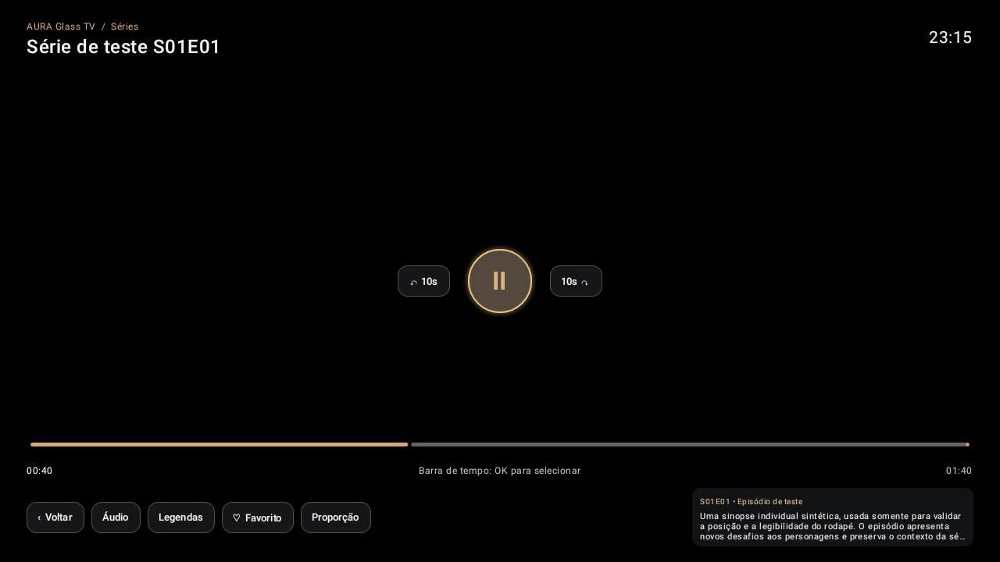
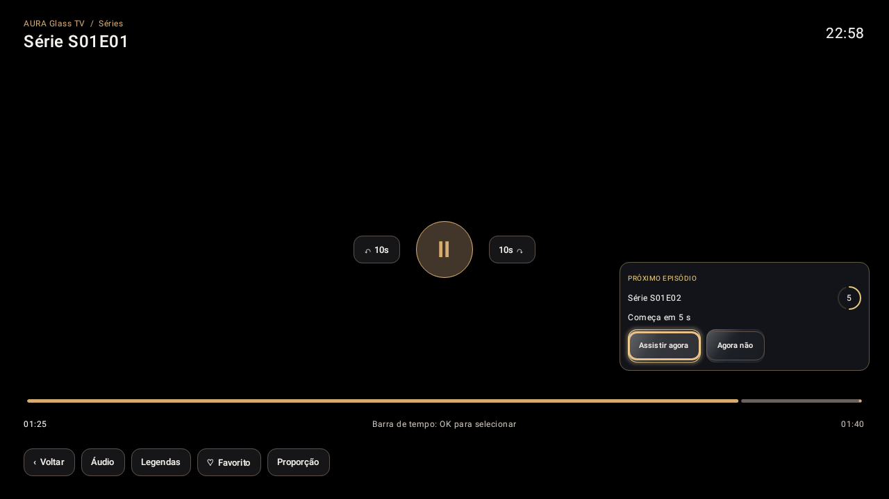

# ✦ AURA GLASS TV

### Sua TV. Seu conteúdo. Sua experiência.

**Beta pública gratuita — Android TV e Google TV**

[**⬇ Baixar AURA Glass TV Premium vc47 (APK oficial)**](https://github.com/eusam66/AURA-Update/releases/download/android-beta-vc47/AURA-Glass-TV-Premium-vc47.apk)

[Notas da versão e assinatura](https://github.com/eusam66/AURA-Update/releases/tag/android-beta-vc47) · [Enviar feedback](https://github.com/eusam66/AURA-Update/issues)

---

## Conheça o AURA Glass TV

O **AURA Glass TV** é um player independente para suas próprias fontes compatíveis de TV ao vivo, filmes e séries. A interface grafite e dourado-champanhe foi construída para Android TV e Google TV, com navegação D-pad e aproveitamento da tela.

**Recursos da beta vc47:**

| Recurso | O que oferece |
|---|---|
| ◈ Visual Glass Premium | Interface escura com foco dourado para controle remoto |
| ▶ Filmes e séries | Capas, categorias, ficha e informações quando disponíveis |
| ▤ TV ao vivo | Navegação de canais e guia EPG conforme a fonte conectada |
| ↪ Continuar assistindo | Histórico, retomada e favoritos |
| ✦ Próximo episódio | Cartão para continuar a série e controle da reprodução |
| ☷ Perfis | Seleção e gerenciamento de perfis, PIN opcional |
| ＋ Fontes próprias | M3U e Xtream Codes de fontes legalmente autorizadas |
| ↑ Atualizações | Infraestrutura AURA Update; esta beta é distribuída inicialmente pelo GitHub |

## Download e instalação

**[Baixar APK Premium vc47 — beta gratuita](https://github.com/eusam66/AURA-Update/releases/download/android-beta-vc47/AURA-Glass-TV-Premium-vc47.apk)**

- **Compatibilidade:** Android TV e Google TV com Android 9 (API 28) ou superior; desempenho varia por dispositivo.
- **Arquivo:** `AURA-Glass-TV-Premium-vc47.apk` · 36.398.825 bytes.
- **SHA-256:** `0efdb60981c4f9ceb083b4eb351647eb00fa6cfbec0654217ca77ad4cfd914dd`.
- **Instalação:** abra o arquivo na TV e confirme a instalação pelo Android, sem ferramentas de terceiros obrigatórias.

> **Atenção a quem já usa o AURA:** a beta vc47 tem certificado diferente do APK público Stable vc36 e **não pode ser instalada como atualização sobre essa versão ou sobre a Lite vc37**. Não desinstale versões antigas sem avaliar perda de dados. Os canais de atualização Stable e Lite não foram apontados para a beta. Esta versão destina-se inicialmente a novas instalações.

## Status da beta e limitações

O **Smart Skip** é experimental, vem **desativado por padrão** e recomendamos mantê-lo desligado. A conferência dos trechos foi testada na Philips, mas os botões de salto automático/manual não foram homologados para distribuição. O player normal, TV ao Vivo, Mini Player e navegação passaram na regressão física da Premium vc47.

Esta é uma **beta gratuita para testes públicos**, não uma promessa de compatibilidade universal. Erros de fontes, episódios sem sinopse e diferenças de listas e decodificadores são possíveis. Não há cobrança nesta beta; condições de futuras edições serão comunicadas separadamente.

## Capturas demonstrativas

*Demonstração técnica sintética do player AURA.*

*Demonstração técnica sintética do próximo episódio.*

## Ajude a desenvolver o AURA

Relate erros e sugestões no GitHub:
- [🐛 Relatar um problema](https://github.com/eusam66/AURA-Update/issues/new?template=bug-report.yml)
- [✨ Sugerir uma melhoria](https://github.com/eusam66/AURA-Update/issues/new?template=feature-request.yml)

Não envie senhas, usuários Xtream, listas, URLs privadas nem dados pessoais nos relatos públicos.

## Informações importantes

**O aplicativo fornece canais, listas, filmes, séries ou assinaturas?** Não. O AURA é somente um player e organizador. Você deve usar suas próprias fontes, de acesso legalmente autorizado. Não há conteúdo incluído.

**É uma versão para Roku, Tizen ou webOS?** Não. Esta beta é exclusiva para Android TV e Google TV.

**Posso atualizar a vc36 pelo AURA Update?** Não para a vc47 beta. As assinaturas diferem e os feeds Stable/Lite foram preservados. Consulte as notas da Release antes de instalar.

**O projeto terá código público?** Não. Este repositório publica somente a página, a documentação e o instalador oficial. O código Android e as chaves de assinatura continuam privados.

**AURA GLASS TV · BETA VC47 DISPONÍVEL**

[Baixar beta vc47](https://github.com/eusam66/AURA-Update/releases/download/android-beta-vc47/AURA-Glass-TV-Premium-vc47.apk)

